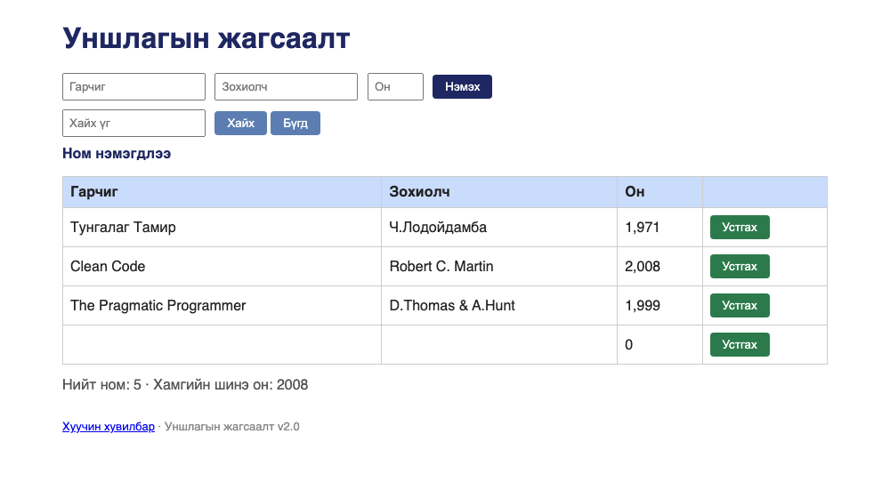

# BUG-01: Нэмэх хэсэгт бүх талбар хоосон байхад ном нэмэгдэж, "Ном нэмэгдлээ" гэж харуулна

Орчин:  Уншлагын жагсаалт v2.0, Chromium 159.0.8154.6 (Playwright), macOS 26.6.2, 2026-11-25
Урьдчилсан нөхцөл: `node app.js`-ийг шинээр асаасан (анхны 3 ном), http://localhost:3000 нээсэн

## Дахин гаргах алхам
1. Гарчиг, Зохиолч, Он гурван талбарыг хоосон үлдээнэ.
2. "Нэмэx" товчийг дарна.

**Хүлээгдэж байсан:** «Ном нэмэхэд Гарчиг, Зохиолч, Он гурван талбар бүгд заавал бөглөгдсөн байх ёстой; дутуу бол ном нэмэгдэхгүй, ойлгомжтой алдааны мессеж харагдана.»
**Бодит үр дүн:** "Ном нэмэгдлээ" мессеж гарч, хүснэгтэд гарчиг, зохиолч хоосон, он нь "0" гэсэн 4 дэх мөр нэмэгдэнэ. Зөвхөн Гарчиг бөглөж, бусдыг хоосон үлдээхэд ч мөн адил нэмэгдэнэ (session 21:08:27).

**Ноцтой байдал:** Major. Үндсэн validation огт ажиллахгүй тул хоосон, утгагүй бичлэг өгөгдөлд хуримтлагдана. Устгаж засах боломжтой тул Critical биш.
**Хавсралт:** screenshots/bug-01.png
**Олдсон аялал:** Couch Potato
