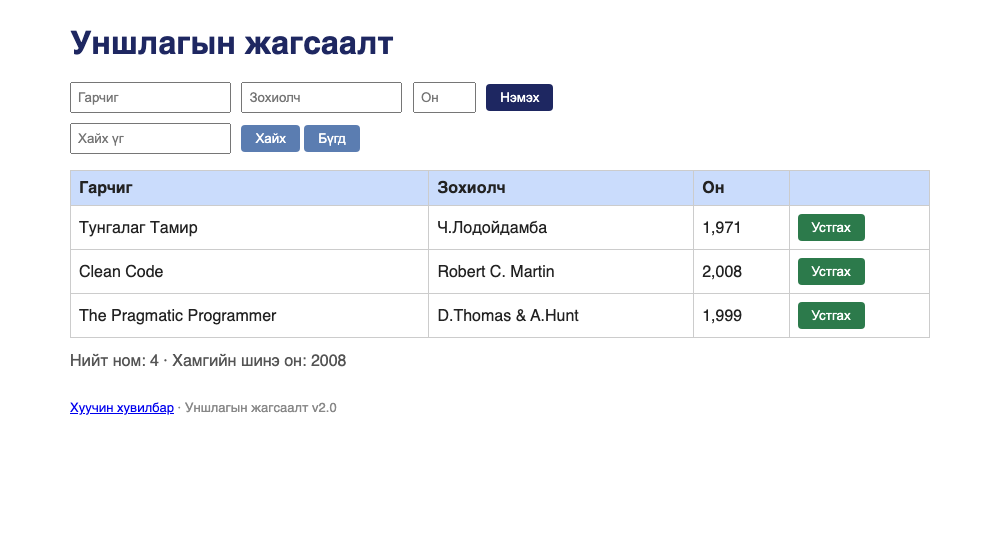

# BUG-02: Хүснэгтийн "Он" багана оныг мянгатын таслалтай ("1,999") харуулна

Орчин:  Уншлагын жагсаалт v2.0, Chromium 159.0.8154.6 (Playwright), macOS 26.6.2, 2026-11-25
Урьдчилсан нөхцөл: `node app.js`-ийг шинээр асаасан (анхны 3 ном), http://localhost:3000 нээсэн

## Дахин гаргах алхам
1. Хүснэгтийн "Он" баганыг харна (өөр үйлдэл хийх шаардлагагүй).

**Хүлээгдэж байсан:** «Он ... хүснэгтэд энгийн тоогоор (жишээ нь 1999) харагдана.»
**Бодит үр дүн:** Анхны 3 номын он "1,971", "2,008", "1,999" гэж таслалтай харагдана. Шинээр нэмсэн ном ч мөн адил ("2,020", session 21:08:28).

**Ноцтой байдал:** Minor. Өгөгдөл зөв хадгалагдсан, зөвхөн харагдац буруу. Гэхдээ бүх мөрөнд илэрдэг бөгөөд "1,999" гэдгийг тоо хэмжээ гэж буруу ойлгох эрсдэлтэй.
**Хавсралт:** screenshots/bug-02.png
**Олдсон аялал:** Supermodel
