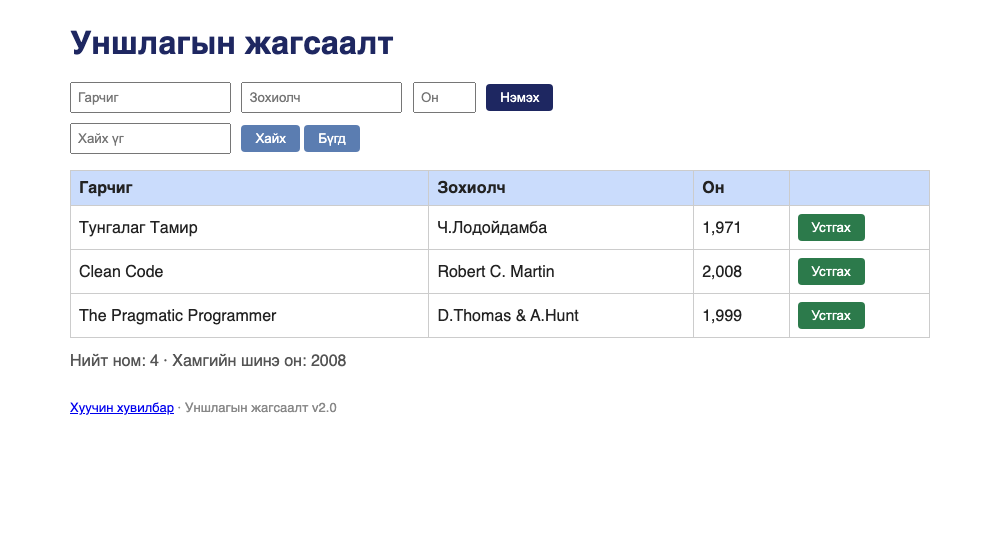

# BUG-03: "Нийт ном" тоолуур хүснэгтийн номын тооноос 1-ээр их харагдана

Орчин:  Уншлагын жагсаалт v2.0, Chromium 159.0.8154.6 (Playwright), macOS 26.6.2, 2026-11-25
Урьдчилсан нөхцөл: `node app.js`-ийг шинээр асаасан (анхны 3 ном), http://localhost:3000 нээсэн

## Дахин гаргах алхам
1. Хүснэгт дэх мөрийн тоог тоолно (3 ном).
2. Хүснэгтийн доорх "Нийт ном" текстийг уншина.

**Хүлээгдэж байсан:** «"Нийт ном" тоолуур хүснэгтэд буй номын тоотой тэнцүү.»
**Бодит үр дүн:** 3 мөртэй байхад "Нийт ном: 4 · Хамгийн шинэ он: 2008" гэж харагдана. Ном нэмж, устгасны дараа ч зөрүү үргэлж +1 хэвээр (session 21:08:27, 21:08:32). API түвшинд ч `GET /api/stats` → `total: 11` байхад `GET /api/books` 10 ном буцаасан (21:08:33).

**Ноцтой байдал:** Minor. Статистик буруу ч үндсэн үйлдэлд нөлөөлөхгүй. Тайлан болон тоонд итгэх итгэлийг бууруулна.
**Хавсралт:** screenshots/bug-03.png
**Олдсон аялал:** Supermodel (Fed-Ex, Saboteur үеэр давтагдсан)
