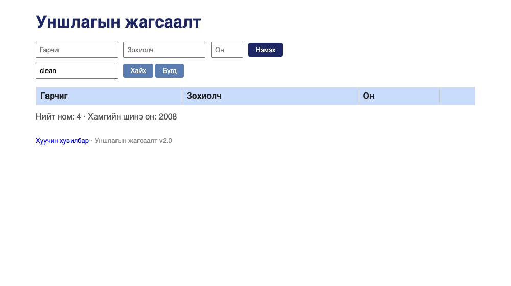

# BUG-04: Хайлт том/жижиг үсэг ялгадаг: "clean" гэж хайхад "Clean Code" олдохгүй

Орчин:  Уншлагын жагсаалт v2.0, Chromium 159.0.8154.6 (Playwright), macOS 26.6.2, 2026-11-25
Урьдчилсан нөхцөл: `node app.js`-ийг шинээр асаасан (анхны 3 ном), http://localhost:3000 нээсэн

## Дахин гаргах алхам
1. "Хайх үг" талбарт `clean` (бүгд жижиг үсгээр) гэж бичнэ.
2. "Хайх" товчийг дарна → хүснэгт хоосон.
3. Талбарыг `Clean` болгоод дахин "Хайх" дарна → "Clean Code" 1 мөр гарна.

**Хүлээгдэж байсан:** «Хайлт гарчиг болон зохиолчоос хайх ба том/жижиг үсэг ЯЛГАХГҮЙ.» Тиймээс `clean` хайхад "Clean Code" гарах ёстой.
**Бодит үр дүн:** `clean` → 0 мөр, `Clean` → 1 мөр. Зохиолчоор хайхад ч мөн адил: `martin` → 0 мөр (session 21:08:31). Скриншот нь алхам 2-ын үеийнх.

**Ноцтой байдал:** Major. Хайлт бол үндсэн функц. Хэрэглэгч ихэвчлэн жижиг үсгээр бичдэг тул байгаа номыг "байхгүй" гэж ойлгоно.
**Хавсралт:** screenshots/bug-04.png
**Олдсон аялал:** Fed-Ex
