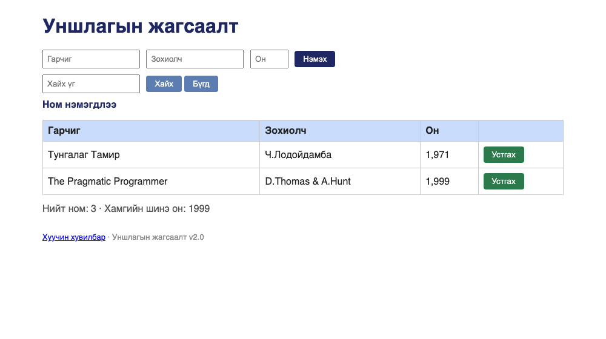

# BUG-06: Ном устгахад "Ном нэмэгдлээ" гэсэн буруу мессеж гарна

Орчин:  Уншлагын жагсаалт v2.0, Chromium 159.0.8154.6 (Playwright), macOS 26.6.2, 2026-11-25
Урьдчилсан нөхцөл: `node app.js`-ийг шинээр асаасан (анхны 3 ном), http://localhost:3000 нээсэн

## Дахин гаргах алхам
1. "Clean Code" мөрийн "Устгах" товчийг дарна.
2. Хүснэгтийн дээрх мессежийг уншина.

**Хүлээгдэж байсан:** «Үйлдэл бүрийн дараах мессеж тухайн үйлдэлдээ тохирно.» Жишээ нь "Ном устгагдлаа".
**Бодит үр дүн:** Ном устгагдаж хүснэгтэд 2 мөр үлдсэн ч "Ном нэмэгдлээ" гэсэн мессеж харагдана.

**Ноцтой байдал:** Minor. Үйлдэл зөв хийгдсэн, зөвхөн санал хүсэлт (feedback) буруу. Гэхдээ хэрэглэгчийг төөрөгдүүлнэ.
**Хавсралт:** screenshots/bug-06.png
**Олдсон аялал:** Fed-Ex
